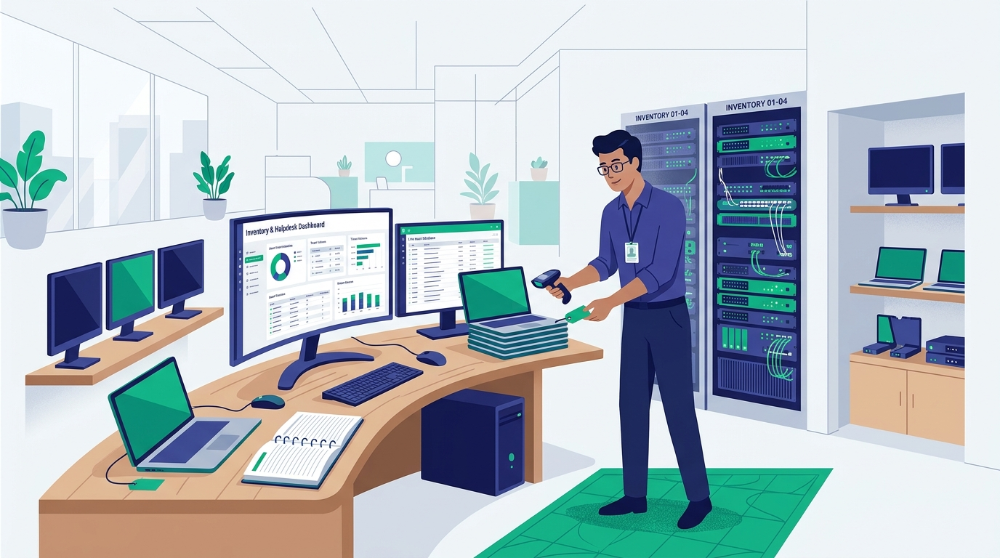
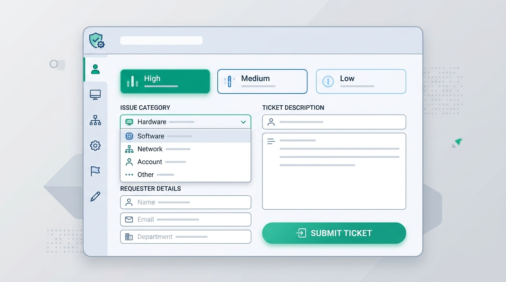
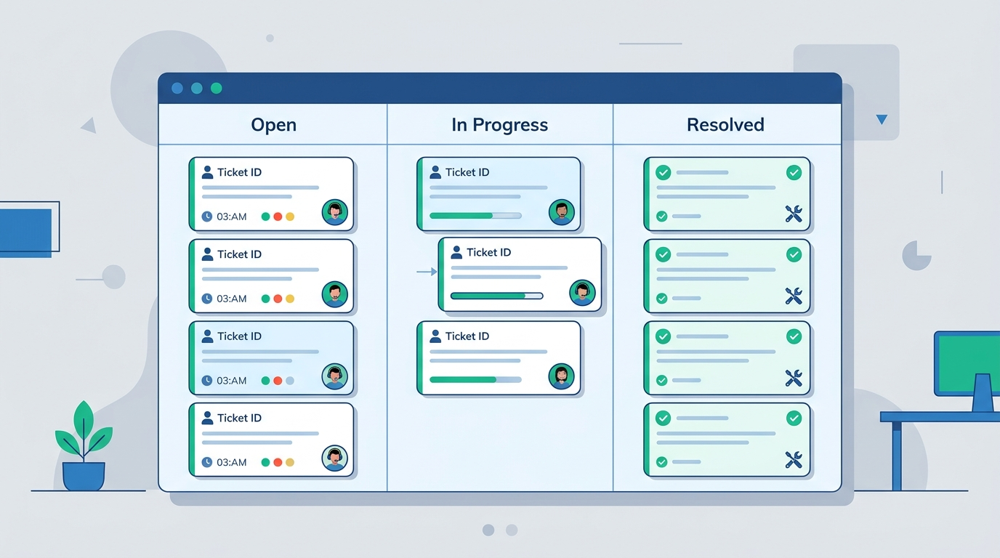
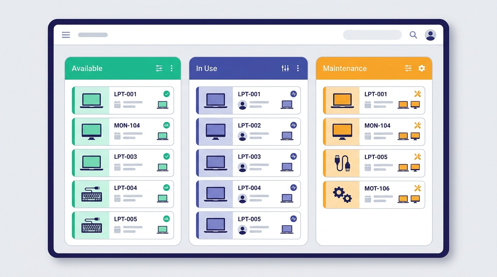

# Helpdesk & Gestão de Estoque Tecnológico

<div align="center">


<br />

<p align="center">
  <strong>Plataforma corporativa de Helpdesk de TI, controle de SLA dinâmico, gestão de custódia patrimonial com fotos otimizadas e emissão de termos com assinatura eletrônica touchscreen.</strong>
</p>

</div>

---

<p align="center">
  
</p>

---

## 📌 Sumário

1. [Visão Geral](#-visão-geral)
2. [Tecnologias Utilizadas](#-tecnologias-utilizadas)
3. [Passo a Passo do Sistema (Com Imagens)](#-passo-a-passo-do-sistema)
   - [Módulo do Colaborador (Funcionário)](#1-módulo-do-colaborador-funcionário)
   - [Módulo do Administrador (TI)](#2-módulo-do-administrador-ti)
4. [Arquitetura do Banco de Dados (Cloud Firestore)](#-arquitetura-do-banco-de-dados)
5. [Políticas de Segurança e Governança](#-políticas-de-segurança-e-governança)
6. [Instalação e Execução Local](#-instalação-e-execução-local)
7. [Como Subir para o GitHub](#-como-subir-para-o-github-passo-a-passo)

---

## 🚀 Visão Geral

O **Helpdesk Embrag** foi desenvolvido para unificar o atendimento de chamados técnicos e o gerenciamento patrimonial de todos os equipamentos de tecnologia da empresa.

### Destaques do Sistema:
- **Acesso Exclusivo e Isolamento do Estoque:** Controle de acesso baseado em papéis (RBAC) com bloqueio tanto na interface quanto nas regras de segurança do servidor Firestore.
- **Rastreamento Físico e de Custódia:** Saiba em tempo real com quem está cada aparelho, em qual unidade, setor e localização física (sala, estação ou depósito).
- **Termos com Assinatura Eletrônica:** Coleta de assinaturas manuscritas no Canvas touchscreen com protocolo oficial (`EMB-TRM-2026-XXXX`).
- **Triagem no Kanban com Atribuição Atômica:** Distribuição justa de chamados entre técnicos sem duplicidade de atendimento.
- **Trilha Imutável de Auditoria:** Snapshots auditáveis antes/depois de cada ação para conformidade com a LGPD e governança corporativa.

---

## 🛠 Tecnologias Utilizadas

| Camada | Tecnologia | Finalidade |
| :--- | :--- | :--- |
| **Frontend Framework** | **React 19** | Biblioteca declarativa de componentes reativos e alta performance. |
| **Linguagem** | **TypeScript 5.x** | Tipagem estrita de contratos de dados, interfaces e validações. |
| **Estilização & UI** | **Tailwind CSS v4** | Design responsivo, temas Claro/Escuro e microinterações polidas. |
| **Ícones** | **Lucide React** | Conjunto coeso de ícones vetoriais modernos. |
| **Banco de Dados** | **Google Cloud Firestore (Native Mode)** | Banco de dados NoSQL NoSQL em tempo real, multi-região e altamente escalável. |
| **Autenticação** | **Firebase Auth & Google Workspace** | Single Sign-On (SSO) com validação de domínio institucional (`@embrag.com.br`). |
| **Assinatura Digital** | **HTML5 Canvas API** | Captura responsiva de assinaturas touchscreen vetorizadas em WebP. |
| **Tratamento de Imagens** | **WebP Canvas Compressor** | Otimização e compressão client-side de fotos para salvar direto no documento. |
| **Build & Dev Server** | **Vite 6** | Inicialização instantânea e empacotamento otimizado. |

---

## 📖 Passo a Passo do Sistema

### 1. Módulo do Colaborador (Funcionário)

<p align="center">
  
</p>

#### Passo 1.1: Acesso Corporativo com Google SSO
- O colaborador acessa o portal e clica em **"Entrar com Google"**.
- O sistema valida a conta `@empresa.com.br` e identifica automaticamente seu nome, e-mail e departamento.

#### Passo 1.2: Abertura de Chamado de Suporte
- Clique em **"+ Novo Chamado"**.
- Preencha o formulário informando a categoria (*Hardware, Software, Rede, Acessos*), a prioridade e a descrição do problema.
- Um número de ticket sequencial é emitido (ex: `TKT-2026-0042`) e o prazo limite de SLA é calculado no ato.

<p align="center">
  
</p>

#### Passo 1.3: Acompanhamento e Notificações
- O colaborador acompanha o andamento na fila em tempo real (*Aberto*, *Em Atendimento*, *Resolvido*).
- O sino de notificações na barra superior alerta sobre novas mensagens e respostas da equipe técnica.

#### Passo 1.4: Assinatura do Termo de Recebimento de Equipamento
- Ao receber um notebook, monitor ou smartphone, o colaborador visualiza a minuta do termo com protocolo oficial.
- A assinatura manuscrita é feita diretamente na tela com o dedo ou com o mouse.

<p align="center">
  
</p>

---

### 2. Módulo do Administrador (TI)

#### Passo 2.1: Triagem de Chamados no Quadro Kanban
- Os técnicos e administradores visualizam as demandas organizadas em colunas visuais.
- Com um clique em **"Assumir"**, o técnico assume a responsabilidade formal pela demanda.
- Suporte a **Notas Técnicas Internas**: diagnósticos confidenciais visíveis apenas para a equipe de TI.

<p align="center">
  
</p>

#### Passo 2.2: Estoque Tecnológico – Cadastro e Visualização em Cartões
- Aba restrita exclusivamente a administradores, agrupando equipamentos em quatro estados:
  - 🟢 **Disponíveis:** Prontos para entrega no depósito de TI.
  - 🔵 **Em Uso:** Vinculados a colaboradores com localização física cadastrada.
  - 🟠 **Em Manutenção:** Equipamentos com avarias em assistência técnica.
  - ⚫ **Baixados:** Bens desativados preservados para fins de auditoria contábil.

<p align="center">
  
</p>

#### Passo 2.3: Movimentações de Custódia (Entrega e Devolução)
- **Entrega:** Seleciona o colaborador e define a localização física obrigatória (Unidade, Setor e Sala/Estação). Gera o termo para assinatura.
- **Devolução:** Desvincula o responsável anterior e **exige o preenchimento manual da nova localização física de guarda** no estoque.
- **Rastreabilidade:** Cada movimentação é registrada de forma imutável em `/inventory_movements`.

---

## 🗄 Arquitetura do Banco de Dados

O banco de dados é operado no **Cloud Firestore** sob o ID de projeto:  
`ai-studio-empresatihelpdesk-37ec10b9-03d7-4226-a63f-3fd3365d34ca`.

```
===================================================================================
                   MAPEAMENTO DE ENTIDADES E RELACIONAMENTOS (DER)
===================================================================================

  [ USERS / SSO ] (email, role: admin | agent | employee)
        │
        ├───────────────────────────────────────────────────────┐
   1:N  │                                                  1:N  │
        ▼                                                       ▼
  ┌───────────────────────────┐           ┌───────────────────────────────────────┐
  │ /tickets                  │           │ /inventory                            │
  │ • PK: id (tkt-...)        │           │ • PK: id (docId)                      │
  │ • UK: code (TKT-001)      │           │ • UK: internalCode (Código único)     │
  │ • FK: requesterEmail      │           │ • SK: assetTag (Nº Patrimônio)        │
  │ • FK: assignedToEmail     │           │ • SK: serialNumber (Nº Série)         │
  │ • priority, status, slaDue│           │ • FK: assignedTo.assignedToEmail      │
  └─────────────┬─────────────┘           │ • category, status, condition, photos │
                │ 1:N                     └───────────────────┬───────────────────┘
                ▼                                             │ 1:N
  ┌───────────────────────────┐                               ▼
  │ /tickets/{id}/comments    │           ┌───────────────────────────────────────┐
  │ • PK: id (cmt-...)        │           │ /inventory_movements                  │
  │ • FK: ticketId            │           │ • PK: id (mov-...)                    │
  │ • FK: authorEmail         │           │ • FK: equipmentId                     │
  │ • isInternal (true/false) │           │ • FK: deliveryTermId ──────────────┐  │
  └───────────────────────────┘           │ • FK: performedByEmail (Admin)     │  │
                                          │ • previousResponsible/Location     │  │
                                          └────────────────────────────────────┼──┘
                                                                 1:1 (entrega) │
                                                                               ▼
                                          ┌───────────────────────────────────────┐
                                          │ /delivery_terms                       │
                                          │ • PK: id (term-...)                   │
                                          │ • UK: protocol (EMB-TRM-...)          │
                                          │ • FK: equipmentId, recipientEmail     │
                                          │ • recipientSignature (Canvas WebP)    │
                                          └───────────────────────────────────────┘
```

---

## 🛡 Políticas de Segurança e Governança

As regras do Firestore (`firestore.rules`) implementam a seguinte matriz de proteção:
1. **Estoque Tecnológico:** Consultas e escritas bloqueadas no servidor para qualquer usuário sem o papel de Administrador.
2. **Imutabilidade em Logs:** As coleções `/inventory_movements` e `/audit_logs` possuem a diretiva estrita `allow update, delete: if false;`. Nenhuma movimentação ou registro de log pode ser alterado ou apagado.
3. **Compressão WebP Local:** As imagens opcionais dos equipamentos são redimensionadas no navegador e armazenadas em WebP compactado, eliminando dependência de buckets abertos ou custos adicionais.

---

## 💻 Instalação e Execução Local

### Pré-requisitos
- **Node.js:** Versão 18.x ou superior (recomendado 20.x ou 22.x).
- **NPM:** Versão 9.x ou superior.

### 1. Clonar o Repositório
```bash
git clone https://github.com/SEU_USUARIO/helpdesk-embrag.git
cd helpdesk-embrag
```

### 2. Instalar as Dependências
```bash
npm install
```

### 3. Configurar Variáveis de Ambiente
Copie o arquivo de exemplo:
```bash
cp .env.example .env
```

*(O arquivo `firebase-applet-config.json` já contém a identificação da base de dados e do cliente de autenticação Google).*

### 4. Executar em Modo de Desenvolvimento
```bash
npm run dev
```
O sistema estará disponível em: `http://localhost:3000`.

### 5. Compilar para Produção
```bash
npm run build
```

---

## 📤 Como Subir para o GitHub (Passo a Passo)

Siga os comandos abaixo no seu terminal para enviar o projeto ao seu repositório no GitHub:

### Passo 1: Inicializar o Repositório Git Local
```bash
git init -b main
```

### Passo 2: Adicionar todos os arquivos
```bash
git add .
```

### Passo 3: Criar o Primeiro Commit
```bash
git commit -m "feat: implementacao completa do Helpdesk e Estoque Tecnologico Embrag"
```

### Passo 4: Conectar ao Repositório Remoto no GitHub
Crie um novo repositório vazio no GitHub (ex: `helpdesk-embrag`) e vincule com o comando:
```bash
git remote add origin https://github.com/SEU_USUARIO/helpdesk-embrag.git
```
*(Substitua `SEU_USUARIO` pelo seu nome de usuário no GitHub).*

### Passo 5: Enviar os Arquivos
```bash
git push -u origin main
```

Pronto! Seu projeto estará publicado no GitHub com documentação visual, fotos, arquitetura de banco de dados e instruções completas para qualquer membro da equipe.

---

<div align="center">
  <sub>Desenvolvido com foco em alta disponibilidade, conformidade com a LGPD e governança corporativa de TI para a Embrag.</sub>
</div>
